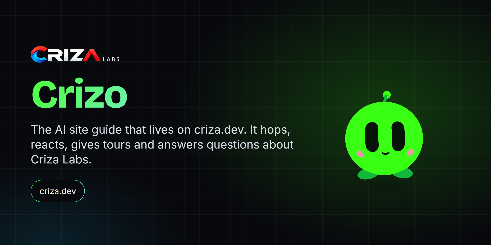
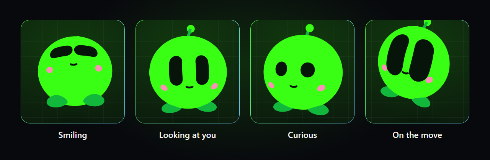

# Crizo: the AI site guide that lives on criza.dev

**A product of [Criza Labs](https://criza.dev)**, designed and built by [AbrarAli S.](https://criza.dev/about/team#abrar-ali) ([GitHub](https://github.com/AbraraliS))

   

**[Meet Crizo on criza.dev](https://criza.dev/)** · [The story of Crizo](https://criza.dev/blog/meet-crizo-ai-site-guide) · [Portfolio entry](https://criza.dev/portfolio#crizo) · [How we built this website](https://criza.dev/about/this-website) · [llms.txt](https://criza.dev/llms.txt) · Made by [Criza Labs](https://criza.dev)

**Crizo is the mascot and AI site guide of Criza Labs**, a software studio in Gujarat, India that builds websites, apps and AI automation. Crizo lives on [criza.dev](https://criza.dev): a small neon-green character that hops around the page, perches on headings and cards, points out useful buttons, gives a step-by-step tour of each page, and answers questions about Criza Labs in a chat. Visitors can send Crizo to rest at any time.

> This repository is the public page for Crizo. It explains what Crizo is and links to the live website. Crizo's source code is not published here.

## What Crizo does

- **Lives on the page.** Crizo hops in small arcs, sits at the end of headings and on the edges of cards, and rides along with them as you scroll. When it has somewhere new to be, it goes there directly.
- **Points the way.** When you stop scrolling near a key button, such as getting a project quote, Crizo walks over, looks at it and says one short line, and the button pulses briefly.
- **Gives a guided tour.** "Take a tour with Crizo" walks through a page step by step, with Back, Next and Stop controls and full keyboard support.
- **Talks and reacts.** Crizo comments in a speech bubble, reacts to links and buttons, celebrates when a contact form is sent, and moves its mouth while it talks.
- **Answers questions.** The chat, Crizo AI, answers questions about Criza Labs from the website's own content and suggests up to three relevant pages.
- **Steps aside when asked.** Hover over Crizo (or tap a sleeping Crizo on a phone) to let it rest. It goes back to its corner and stays quiet until you wake it.

## Crizo's expressions

Crizo has moods for the moments that matter on a website: waking up, curious, happy, excited, laughing, surprised, confused, shy, celebrating, listening while you type, talking while it answers, and drowsy, then asleep after a long pause.

## Crizo AI: the chat

- **Stays on topic.** Crizo AI answers only about Criza Labs: its services, work, products ([CrizaVoise](https://voise.criza.dev) and [CrizaTools](https://tools.criza.dev)), process and how to start a project.
- **Grounded in the website.** Answers come from the site's own published content, with links only to real pages on criza.dev.
- **Refuses what it should.** Unrelated requests, attempts to override its instructions, and requests for code get a short reminder of what it can help with.
- **Sends legal questions to the source.** Questions about privacy, terms or cookies are pointed to the [privacy policy](https://criza.dev/privacy) and [terms](https://criza.dev/terms-and-conditions) pages instead of being answered in the chat.
- **Always has an answer.** When AI is unavailable, Crizo gives a short, fixed answer from the site, so the chat keeps working.
- **Says it is AI.** The chat is clearly labelled Crizo AI, with a link to the privacy policy under the input.

## Built with care for access and speed

- **Reduced motion respected.** Visitors who prefer less motion see Crizo still, with no walking or bouncing.
- **Keyboard and screen readers.** The chat is a proper dialog with focus handling, Escape to close and a live message log; Crizo's decorative drawing is hidden from screen readers.
- **Light on the page.** Crizo loads after the page is ready, pauses when off screen and stops working when it settles, so it does not slow the website down.
- **Never interrupts typing.** Crizo stays quiet while you type in a form, and its lines are short and limited so it never nags.
- **An off switch.** Rest mode turns off walking, talking and reactions, and the choice is remembered in your browser.

## Design principles

Crizo was designed around a few lessons about on-screen helpers:

1. **Earn attention.** Point at something only when it helps, briefly, and stop when ignored.
2. **Use gaze before words.** Crizo looks and leans toward what it points out; a face looking at something draws the eye there.
3. **Stay brief.** Motion and highlights last a moment, never a constant loop.
4. **Respect the visitor.** No interruptions while typing, no guessing at facts, and a clear way to make it stop.

## Frequently asked questions

**What is Crizo?**
Crizo is the mascot and AI site guide of Criza Labs on criza.dev. It helps visitors find services, explore work and see how to start a project, through page tours, short pointers to key buttons and a chat.

**Who made Crizo?**
Crizo was designed and built by [AbrarAli S.](https://criza.dev/about/team#abrar-ali), co-founder of Criza Labs.

**Is Crizo an AI chatbot?**
Partly. Crizo AI answers questions about Criza Labs from the website's own content. Crizo's tours, pointers and comments are written in advance.

**Can I turn Crizo off?**
Yes. Hover over Crizo, or tap it while it sleeps on a phone, and let it rest. It returns to its corner and stays quiet until you wake it.

**Can Criza Labs build an assistant like Crizo for my website?**
Yes. Criza Labs builds AI assistants and guides for business websites, shaped around your own content and goals. [Tell us about your project](https://criza.dev/contact).

## About Criza Labs

[Criza Labs](https://criza.dev) is a founder-led software studio in Gujarat, India, building websites, apps and AI automation for growing businesses. You work directly with the founders, see your project working from week one and own the code when it ships.

More from Criza Labs:

- [CrizaVoise](https://voise.criza.dev): free, open-source offline billing software for small businesses. [Source on GitHub](https://github.com/CRIZA-LABS/crizavoise)
- [CrizaTools](https://tools.criza.dev): free online tools that run in your browser. [Index on GitHub](https://github.com/CRIZA-LABS/crizatools)

## Contact

- Website: [criza.dev](https://criza.dev)
- Projects: [contact@criza.dev](mailto:contact@criza.dev)
- General: [info@criza.dev](mailto:info@criza.dev)

---

Crizo, the Crizo character and the Criza Labs name and logo belong to Criza Labs. All rights reserved.
